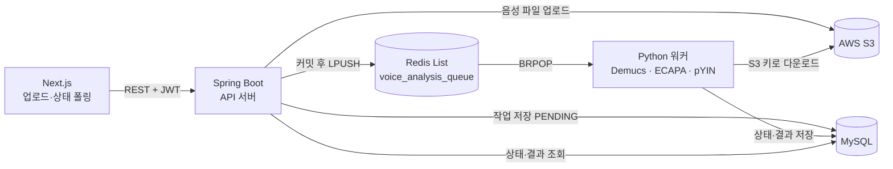

# MyVoicePick

노래한 녹음을 올리면 음색이 닮은 가수와, 내 음역에 맞는 다음 곡과 키를 추천하는 서비스입니다.

- **개발 형태:** 1인 개인 프로젝트 (2026.04 – 2026.05, 추천 방식 개편 2026.10)
- **핵심 과제:** 보컬 분리·음성 분석처럼 무거운 작업을 웹 요청에서 떼어내 비동기로 처리하고, 추천 품질을 측정할 수 있는 방식으로 만들기
- **구성:** Next.js 클라이언트 · Spring Boot API 서버 · Python 분석 워커

## 배포 사이트

https://my-voice-pick.vercel.app/

- 클라이언트: Vercel (`main` 브랜치 자동 배포)
- API 서버 · 분석 워커 · MySQL · Redis: AWS Lightsail 인스턴스 1대 (2 vCPU, RAM 2GB)

## 시스템 구조



1. 클라이언트가 녹음 파일을 올리면 API 서버가 S3에 저장하고 분석 작업(`PENDING`)을 DB에 기록합니다.
2. API 서버는 **202 Accepted**와 작업 ID를 바로 돌려줍니다. 분석이 끝날 때까지 요청을 붙잡지 않습니다.
3. DB 커밋이 끝난 뒤 Redis 큐에 작업을 넣고, Python 워커가 꺼내 보컬을 분리하고 음색·음역을 측정해 곡을 추천합니다.
4. 워커가 결과를 DB에 쓰면, 클라이언트는 작업 ID로 상태를 폴링해 결과를 받습니다.

## 추천 방식

사용자 녹음과 곡을 **같은 기준으로 측정**하고, 음색과 음역을 함께 봅니다. 유료 API 없이 서버에서 직접 실행합니다.

### 곡 데이터 (사전 구축)

- 멜론 장르 차트(발라드·댄스·R&B·록·인디)에서 곡 목록을 모으고, iTunes 30초 미리듣기를 받습니다.
- Demucs로 보컬을 분리하고 두 가지를 측정해 `songs.analysis_profile`에 저장합니다.
  - **음색:** SpeechBrain ECAPA 화자 임베딩 (192차원)
  - **음역:** pYIN 음높이의 p10 · p50 · p90 (노래한 구간만)
- 현재 302곡, 가수 164명. 사람이 곡을 하나씩 넣지 않고 자동으로 수집합니다.

### 사용자 녹음 분석

- 녹음이 75초 이하면 전체를, 길면 곡의 30% · 70% 지점에서 30초씩(절 + 후렴) 잘라 보컬을 분리합니다.
- 곡과 같은 방법으로 음색 임베딩과 음역을 측정합니다.

### 순위와 키 판단

| 항목 | 규칙 |
| --- | --- |
| 점수 | 음색 유사도 순위(백분위) 60% + 음역 40% (녹음 음역 안에 들어오는 정도, 곡이 머무는 높이) |
| 다양성 | 추천 5곡은 가수당 1곡 |
| 키 | 곡이 녹음에서 낸 최고음을 넘을 때만 내리고, 곡이 낮으면 원키 그대로 |
| 정보 부족 | 녹음에서 들린 음역이 7반음보다 좁으면 키는 판단하지 않고 그 이유를 적음 |
| 미리듣기 한계 | 곡의 높은 부분이 녹음 최고음과 3반음 안이면 순위를 낮추고 "클라이맥스가 더 높을 수 있다"고 적음 |

결과 화면에는 측정한 값만 보여 줍니다(녹음에서 들린 음역, 음색이 닮은 가수, 추천 이유). 근거가 없는 0~100점 능력 점수는 쓰지 않습니다.

## 기술 스택

| 영역 | 기술 |
| --- | --- |
| API 서버 | Java 17, Spring Boot 4.0, Spring Data JPA, Spring Security (OAuth2 로그인, JWT) |
| 분석 워커 | Python, Demucs(htdemucs), SpeechBrain(ECAPA), librosa(pYIN), SQLAlchemy |
| 데이터 | MySQL, Redis (작업 큐) |
| 인프라·연동 | AWS S3, AWS Lightsail, Vercel, 토스페이먼츠 |
| 클라이언트 | Next.js, TypeScript |

## 주요 설계와 트러블슈팅

### 1. DB 커밋 전에 워커가 작업을 읽는 문제

**문제:** 작업 저장(`save`) 직후 같은 트랜잭션 안에서 Redis에 발행하면, 커밋 전에 워커가 메시지를 받아 DB를 조회합니다. 이때 "작업 없음"이 발생했습니다.

**해결:** `TransactionSynchronizationManager.registerSynchronization()`의 `afterCommit()`에서 발행하도록 바꿨습니다. 커밋이 끝난 작업만 워커에게 전달됩니다. 발행 자체가 실패하면 작업을 `FAILED`로 바꿉니다.

→ `AnalysisService.requestAnalysis()`

### 2. 무거운 분석과 웹 요청 분리

보컬 분리와 음성 분석은 CPU를 많이 쓰고 오래 걸립니다. API 서버는 작업을 접수만 하고 응답합니다. 분석은 Redis 큐를 소비하는 워커가 순서대로 처리합니다. 여러 워커가 같은 큐를 나눠 처리할 수 있어, 자원이 늘면 워커만 추가하면 됩니다.

### 3. 파일 접근 보안

S3 버킷은 공개하지 않습니다. 대기열 메시지에는 S3 키만 담고, 워커가 자신의 자격 증명으로 내려받습니다. 처음에는 10분짜리 Presigned URL을 전달했는데, 대기가 길어지면 처리 시점에 만료되는 문제가 있어 바꿨습니다. 업로드 파일은 `FileValidator`로 확장자(mp3, wav, m4a)와 MIME 타입을 검사합니다.

API는 모두 로그인이 필요하며, 인증 없이 호출하면 401을 돌려줍니다. 분석 상태 조회는 본인 작업만 가능합니다.

### 4. 끝나지 못한 작업 정리

워커가 대기열에서 작업을 꺼낸 뒤 비정상 종료되면 메시지는 사라지고 상태는 `PROCESSING`에 남습니다. 접수 후 30분이 지나도 끝나지 않은 작업(`PENDING`, `PROCESSING`)은 스케줄러가 `FAILED`로 바꿉니다. 사용자는 무한 대기 대신 실패를 보고 다시 요청할 수 있습니다. 기준이 접수 시각이라 생기는 문제는 [남아 있는 한계](#남아-있는-한계)에 적었습니다.

→ `StaleAnalysisTaskScheduler`

### 5. 음량이 음색을 덮던 추천

**문제:** 어떤 녹음을 넣어도 비슷한 곡이 추천됐습니다. 곡끼리 유사도를 재 보니 모두 0.98 안팎이었습니다.

**원인:** 평균 MFCC의 첫 값(c0)은 소리 크기라 다른 값보다 수십 배 컸습니다. 음색이 아니라 녹음 음량으로 곡을 고르고 있었습니다.

**해결:** c0를 빼고 곡 전체 기준으로 표준화했고, 이어서 음색 비교를 ECAPA 화자 임베딩으로 바꿨습니다. 같은 시험으로 매번 확인했습니다.

| 시험 | 기존 (평균 MFCC) | 개선 |
| --- | --- | --- |
| 같은 곡의 음량만 바꿔 넣었을 때 자기 곡을 1위로 찾음 (56곡) | 6곡 | 56곡 전부 (c0 제거 · 표준화) |
| 같은 가수의 다른 곡을 1위로 찾음 (302곡, 무작위 2%) | 36% | 65% (ECAPA) |

→ `ai-worker/voice_match.py`, `python recommend_local.py eval`

### 6. 녹음의 어느 부분을 분석할지

처음에는 15초 지점부터 45초만 분석했습니다. 낮은 절만 잡힌 녹음에서 들린 음역이 5반음뿐이라 "-6키" 같은 잘못된 제안이 나왔습니다. 세 가지를 실측해 비교했습니다 (4분 녹음, 이 PC 기준).

| 분석 구간 | 보컬 분리 시간 | 들린 음역 |
| --- | --- | --- |
| 15초부터 45초 | 29초 | 5반음 |
| **30% · 70% 지점 30초씩** | **31초** | **13반음** |
| 곡 전체 | 183초 | 14반음 |

분리 시간은 거의 그대로이면서 음역은 곡 전체의 약 90%까지 잡히는 두 구간 방식을 골랐습니다.

→ `AnalysisService.trim_command()`

## 성능

운영 서버(Lightsail 2 vCPU, RAM 2GB)에서 4분짜리 녹음 한 건을 분석하는 데 **약 2분 50초**가 걸립니다.

| 단계 | 시간 |
| --- | --- |
| 다운로드 · 구간 자르기 | 4초 |
| 보컬 분리 (Demucs) | 1분 53초 |
| 모델 로드 · 음색·음역 측정 · 매칭 | 49초 (ECAPA 모델은 워커 시작 후 처음 한 번만 로드) |

워커는 한 번에 한 건씩 처리하므로 **시간당 약 21건**이 한계입니다.

## 남아 있는 한계

| 한계 | 지금 감당하는 방법 | 바꿀 조건 |
| --- | --- | --- |
| 동시 처리량: 워커 1개, 건당 약 2분 50초 → 시간당 약 21건. 100명이 한꺼번에 요청하면 100번째는 약 4시간 40분 대기 | 한 사람당 진행 중인 분석은 1건만 받음 (429). 큐 구조라 워커 추가로 확장 가능 | 반주 없는 녹음은 보컬 분리 생략, 더 큰 서버에서 워커 추가, GPU 워커 |
| 30분 실패 기준이 **접수 시각**이라, 대기열이 10건 넘게 밀리면 기다리다 `FAILED`가 될 수 있음 | 아직 해결 전 (알려진 문제) | 기준을 처리 시작 시각으로 변경 |
| 워커가 처리 중 종료되면 그 작업은 자동으로 다시 처리되지 않음 | 30분 뒤 `FAILED`로 바꿔 사용자가 다시 요청 | 유실이 잦아지면 `LMOVE` 처리 중 목록이나 Redis Streams로 자동 재처리 |
| 곡 데이터가 iTunes 30초 미리듣기 기준이라 클라이맥스가 빠질 수 있음 | 곡 최고음이 녹음 최고음에 가까우면 순위를 낮추고 주의 문구 표시 | 곡 전체 음원을 쓸 수 있을 때 다시 측정 |
| 녹음에서 들린 음역은 편하게 부를 수 있는 음역과 다름 | 화면에 "이번 녹음에서 측정한 값"으로 표시, 음역이 좁으면 키 판단 안 함 | 음역 테스트 녹음이나 "어려워요" 피드백 수집 |
| ECAPA는 "얼마나 닮았는지"만 알려 주고 "어디가 닮았는지"는 설명하지 못함 | 추천 이유는 측정값(음색 순위, 음역, 키)만으로 작성 | 목소리 묘사를 검증할 수 있는 모델이 생길 때 |
| 분석 이력을 삭제해도 S3의 원본 음성은 남음 | 버킷 비공개, 워커만 S3 키로 접근 | 이력 삭제 시 S3 객체도 삭제 |
| 결제 승인 시 금액을 클라이언트 요청 값으로 사용 | 토스페이먼츠 테스트 키로만 동작 | 실결제 전에 주문 생성 시 서버가 금액을 확정하고 승인 시 대조 |

## 로컬 실행

### 준비 사항

- JDK 17, Python 3.10+, Node.js 18+
- MySQL, Redis 실행 중
- FFmpeg (워커의 오디오 전처리에 필요)
- AWS S3 버킷과 접근 키
- 소셜 로그인(Google·Naver·Kakao), 토스페이먼츠 테스트 키 (해당 기능 사용 시)

### 1. API 서버

`src/main/resources/application.yml.template`을 복사해 `application.yml`을 만들고 값을 채웁니다. `application.yml`은 Git에 올라가지 않습니다.

필요한 설정 키:

- `spring.datasource.*`, `spring.data.redis.*`
- `spring.security.oauth2.client.registration.{google,naver,kakao}.*`
- `spring.jwt.secret`, `spring.jwt.expiration-time`
- `spring.cloud.aws.credentials.*`, `spring.cloud.aws.region.static`, `spring.cloud.aws.s3.bucket`
- `toss.payment.secret-key`, `app.frontend-url`

```bash
./gradlew bootRun
```

AWS 키 등을 환경 변수(`${AWS_ACCESS_KEY_ID}` 등)로 넣었다면, 그 환경 변수를 불러온 셸에서 실행해야 합니다.

### 2. 분석 워커

`ai-worker/.env`를 만들고 아래 키를 채웁니다.

```env
REDIS_HOST=localhost
REDIS_PORT=6379
REDIS_QUEUE_NAME=voice_analysis_queue
DATABASE_URL=mysql+pymysql://<user>:<password>@localhost:3306/voicepick_db
AWS_ACCESS_KEY_ID=
AWS_SECRET_ACCESS_KEY=
AWS_DEFAULT_REGION=
AWS_S3_BUCKET=
```

```bash
cd ai-worker
pip install -r requirements.txt
python main.py
```

ECAPA 모델(약 80MB)은 처음 분석할 때 Hugging Face에서 내려받아 `ai-worker/temp/ecapa`에 둡니다. 미리 받으려면:

```bash
python -c "from voice_match import encoder; encoder()"
```

### 3. 곡 데이터 구축

추천 대상 곡은 아래 순서로 만듭니다. 미리듣기와 분리한 보컬은 `ai-worker/temp/`에 저장되며 Git에 올라가지 않습니다.

```bash
cd ai-worker
python recommend_local.py build --melon 60   # 장르별 60곡: 미리듣기 수집 → 보컬 분리 → 음색·음역 측정
python recommend_local.py export-db          # DATABASE_URL의 songs 테이블에 반영
python recommend_local.py eval               # 같은 가수 찾기 시험 (ECAPA vs 평균 MFCC)
```

녹음 파일로 추천 결과를 바로 확인할 수도 있습니다. 같은 사람의 녹음 여러 개를 주면 합쳐서 추천합니다.

```bash
python recommend_local.py recommend 녹음1.m4a 녹음2.m4a
```

곡 목록 수집은 멜론 차트 페이지와 iTunes Search API를 사용합니다. 각 서비스의 이용 조건을 확인한 뒤 사용하세요.

### 4. 클라이언트

`myvoicepick-client/.env.local`에 `NEXT_PUBLIC_TOSS_CLIENT_KEY`를 설정합니다.

```bash
cd myvoicepick-client
npm install
npm run dev
```

## API

| 메서드 | 경로 | 설명 |
| --- | --- | --- |
| POST | `/api/v1/analyze` | 음성 파일 업로드, 분석 요청 (202 + taskId) |
| GET | `/api/v1/analyze/{taskId}/status` | 분석 상태·결과 조회 |
| GET | `/api/v1/analyze/my-latest` | 내 최신 분석 결과 |
| GET | `/api/v1/analyze/my-history` | 내 분석 이력 |
| DELETE | `/api/v1/analyze/{taskId}` | 내 분석 이력 삭제 |
